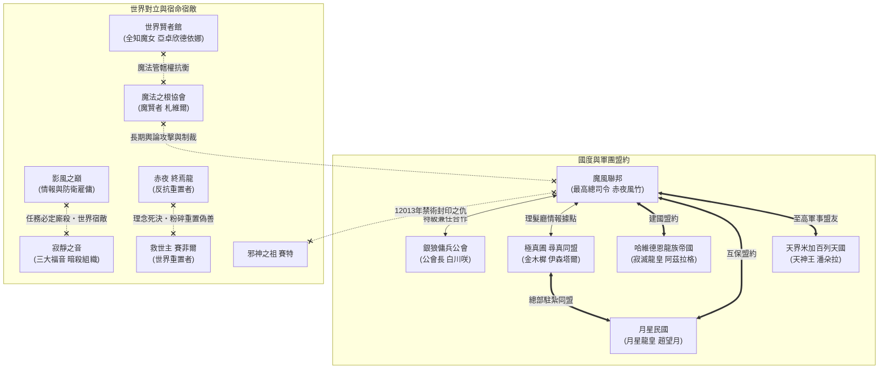

# 亞雷利塔 ARELITA 角色關係全景圖譜與陣營網絡總覽檔案

> **記錄時間**：2026-11-11 01:29:43
> **涵蓋範圍**：五界全領域・20 大陣營・14 大傳奇宗族・全 175 位角色・165 條官方正史精煉關係鏈
> **互動可視化工具**：已同步建置獨立視覺化圖表系統 [`relations.html`](relations.html)，支援力導向互動星網、家族血脈樹、軍政階層樹與全角色人際雙向檢索。

---

## 目錄
1. [世界觀架構與五界核心格局](#一世界觀架構與五界核心格局)
2. [宏觀陣營關係與外交對立圖譜（Mermaid 圖表）](#二宏觀陣營關係與外交對立圖譜)
3. [魔風聯邦軍政最高樞紐與八大軍團部署](#三魔風聯邦軍政最高樞紐與八大軍團部署)
4. [十四大名門宗族與傳奇血脈譜系](#十四大名門宗族與傳奇血脈譜系)
5. [極真圃六識真之花與跨界同盟網](#五極真圃六識真之花與跨界同盟網)
6. [世界級宿敵與歷史封印死結](#六世界級宿敵與歷史封印死結)
7. [全 175 位角色人際關係索引總表](#七全-175-位角色人際關係索引總表)

---

## 一、世界觀架構與五界核心格局
亞雷利塔的世界分為**現界、魔界、天界、冥界、幻想界**五大領域，五界並無高低尊卑之分：
- **現界**：無限廣闊，以地球為核心文明聚集地，亦是魔風聯邦、月星民國、日天聯邦、卡姆利亞獸人聯邦、哈維德恩龍族帝國等諸國所在地。
- **魔界**：垂直有限水平無限（共 9 層），惡魔族的故鄉。由原初三魔神（別西卜、路西法、貝利爾）以及最古老的名門凱撒家族統治。
- **天界**：浮空島嶼遍布的無垠聖域，天使與天神所居之地。由天使神祖米迦勒結晶中誕生的天神王潘朵拉統治。
- **冥界**：死者歸宿與亡靈之地，層級每 24 小時隨機互換。由亡靈神赤夜風竹、死神三人組（張琦、莉琪雅、凱）、黑神後裔黑卡蒂等坐鎮。
- **幻想界**：球型三層世界，約火星大小，幻想種聚居地。
- **外界與世界樹**：世界樹支撐萬物資訊，而界外為「虛空」，居住著深不可測的虛界之神（如邪神賽特、救世主賽菲爾引發之世界重置危機）。

## 二、宏觀陣營關係與外交對立圖譜

## 三、魔風聯邦軍政最高樞紐與八大軍團部署
魔風聯邦是現界乃至全界最強盛的軍事與政治同盟，由赤夜風竹於 12017 年奠基建國：

### 1. 聯邦最高指揮樞紐
- **魔風聯軍最高總司令**：`赤夜 風竹`（極惡之師、亡靈之神。做事雷厲風行、用軍如鬼，誓死守護親友家人）
- **魔風聯軍副總司令**：`阿撒托斯 阿斯拉 凱撒`（屠掠魔神、惡魔劍聖，魔界凱撒長子，風竹生死莫逆之交）
- **魔風聯軍總參謀長**：`索亞德 托斯卡 撒旦`（智慧魔神，路西法以神權創造之智者，掌管國家大腦）
- **司令秘書**：`銀 塵夜`（銀色的秘書，掌理核心文件、政務統籌與總司令貼身隨侍）

### 2. 赤夜風竹直屬專屬隱密部隊【冥府神傑】（共 9 席）
> 成立於 12023 年，知情者極少。專門執行非公開之超高難度滅世級任務，合力戰力可抵軍團總和。

| 席次 | 姓名 | 稱號 / 職能 | 核心關係與備註 |
| :--- | :--- | :--- | :--- |
| **第一傑** | 黑卡蒂 拉普拉斯 | 黑神後裔、亡靈美女神 | 神王級戰力，冥界秩序守護者；霸道聲稱風竹是其所有物（實際不敢忤逆）、害怕花幽、手下敗將是暗斯卡奇與沃利爾德瑪、曾暗戀終焉龍、愛捉弄涅米與悠 |
| **第二傑** | 克蘭努克 歐塔 | 暗神王的召使、重責哥 | 暗元素族極致古神，誓死終生追隨赤夜風竹；與青黎、艾琳、阿斯克勒好友兼同事；覺得涅米是煩人小鬼 |
| **第三傑** | 艾琳絲塔希 康多拉 | 希爾瓦倫的劍之女神、真斬始祖 | 赤夜家總管家；單戀赤夜風竹（覺得花幽看風竹眼神怪怪的）；將涅米與白雪悠當妹妹照顧；阿撒托斯為師父兼好友；姵莉絲為徒弟；仇恨維璐緹雅與賽西斯 |
| **第四傑** | 福玻斯 里拉 阿斯克勒 | 聖絕的醫傑 | 龍族與血魔雙混血，聯邦最高醫術神匠；視赤夜風竹為恩人與上司；與克蘭努克、艾琳、莎布西絲、凜子好友 |
| **第五傑** | 涅米蘿伊 贊恩斯 | 強慾之女、全能天才 | 當今世上唯一的亡靈神赤夜風竹神明眷屬；單戀赤夜風竹（覺得花幽太黏主人）；與白雪悠是摯友（在悠面前裝成熟）；把艾琳當姐姐；崇拜黑卡蒂想超越她；愛找克蘭搭話 |
| **第六傑** | 莎布西絲 貝西卡 | 母神、戀愛怪人 | 妖精與龍混血古神；暗戀影風之巔卡德 貝利索（德叔！），認定德菈為情敵！；赤夜風竹為上司；與艾琳、阿斯克勒聊得來 |
| **第七傑** | 格赫羅 阿斯拉 凱撒 | 薪炎之魔、暴亂狂徒、鏈魔 | 凱撒家族分支薪火繼承人，豪邁重義；阿撒托斯是大堂哥，艾娜托斯是堂妹；赤夜風竹為上司；與神傑全員普通同事 |
| **第八傑** | 凜子 歐斯拉 時空 | 時空之王、保姆凜 | 墮天使，執掌時空究極法則；赤夜風竹為上司；青黎是需要被自己監護的人；阿斯克勒為好友；與法則神索特塔克夫關係複雜 |
| **第九傑** | 青 黎 | 黑影獵殺者、小黎 | 獸人黑豹與人類混血，極致潛行刺殺王牌；赤夜風竹為上司；凜子為半個監護人；喜歡黑卡蒂；與克蘭、涅米為好友 |

### 3. 魔風正規軍團八大部隊與守護都市
| 部隊名稱 | 將軍稱號 | 將軍姓名 | 守護直轄市 | 都市特色與戰略定位 | 核心部隊成員 |
| :--- | :--- | :--- | :--- | :--- | :--- |
| **雷霆殿** | 神雷將軍 | 雷風 克斯拉 修羅 | 霍普市 (首都) | 商業與最高科技中樞，人口 482 萬 | 蒂雅(妻)、田也嵐心、沈憾、阿爾希亞、羅彌生 |
| **紅蓮組** | 不破將軍 | 烈火 艾克斯 修羅 | 赤羽市 | 日式文化安逸慢活都市，治安最佳 | 村宮早乙女、趙清夏、織田野寺、櫻上千夏 |
| **戰龍** | 煌龍將軍 | 雷格納 尼達羅斯 | 亞美特市 | 重工業與軍事基地，兵器博物館 | 淺野歆音、伊絲波伽德、西格德、忻天、李榮、芬里斯 |
| **潔白協奏** | 神曲將軍 | 蘿雅絲 瑟 阿爾法 | 瑪捷塔市 | 地中海風最大港口，音樂藝術之都 | 白川咲、奎札爾、淺野修司 |
| **夜妖** | 玄狐將軍 | 水無月 夜風 | 天御市 | 中華風格大市集，商業與商會繁盛 | 月影伊萊、白雪悠、旭翼、百夜奈、祈奈魁、修莉雅 |
| **墮天光輝** | 灼炎將軍 | 倷德 歐斯拉 卡迦 | 巴越爾市 | 機械化高科技農田與最大國家公園 | 天桐艾、天霞、伏黑夜、影之 |
| **血魔之影** | 守淵將軍 | 凌音 凜 | 丹格市 | 直面深淵之口，最凶險險峻之要塞 | 凌音澪(妹)、千、血羽佛拉德、蕾涅莉亞 |
| **陰暗幽鬼** | 絕影將軍 | 星野 晴奈 | 阿瑞納市 | 哥德風山城，每年魔風祭競技場 | 星野蒼空(兄/特級)、冥藏七翔 |

### 4. 聯邦獨立特級、特種機關與司法體系
- **獨立特級（特許獨立行動，僅聽令總司令與副司令）**：
  - `赤夜 花幽`：魔斬女武神，赤夜風竹親妹妹，被救回喚醒記憶後守衛家族。
  - `艾娜托斯 阿斯拉 凱撒`：阿撒托斯親妹妹，深淵眷顧者。
  - `白雪 悠`：白雪家族傳承魔劍士，赤夜風竹養子。
  - `寺山 夜明`：日天巾幗武神，享譽大陸的超強女劍聖。
  - `傑瑞 吳 阿爾法`：碎時者，兼任銀狼傭兵公會最高層。
  - `月夜`：魔偶使役者、紫魔劍士。
  - `星野 蒼空`：星之掌控，星野晴奈之兄。
- **獄炎監察部隊**：大隊長 `炎火 加拉爾`（王子）、`憂娜 加拉爾`（公主妹）、`有栖 櫻雪`、`哲也 和人`、`納克 狄姆`、`姵莉絲 阿斯拉 克里`。專職監督魔風各機關，防止貪腐叛變。
- **特殊事件對策組（SECT）**：組長 `鹿苑寺 照寺`，隊員 `矢野 海翔`、`中野 繪里`、`狙櫻`、`柳霧`、`蒼`、`蒼風 貓音`、`賴 亭瑋`。處理緊急重大突發與反恐情資。
- **魔風國家公共安全局**：總局長 `秦 雲平`（黑空之龍），負責八市巡邏與學院島治安防衛。
- **魔風審判庭**：最高審判官 `芙拉達 莎德琺`，獨立執掌聯邦律法與裁決。

## 四、名門宗族與傳奇血脈譜系

> [!IMPORTANT]
> ### 【世界觀核心命名體系與類型名架構：釐清「阿斯拉」的真正含義】
> 依據《亞雷利塔基本設定》，天界、魔界、墮天使三大神魔種族在命名上遵循嚴謹的**「名字・類型名・姓氏」**三段式結構：
> - **姓氏**：代表血緣傳承與名門宗族（如：凱撒家族、修羅一族、撒旦魔神族、卡迦家族等）。
> - **類型名（中間名）**：代表個體天生具備的神魔特質、靈魂本源與命運職能，分為三大類型：
>   1. **統御型**（司掌紛爭、力量、統治、開拓）：
>      - **惡魔族**：**阿斯拉 (Asura)**，如：阿撒托斯・阿斯拉・凱撒、格赫羅・阿斯拉・凱撒、別西卜・阿斯拉・撒旦、姵莉絲・阿斯拉・克里。
>      - **天使族**：**克斯拉 (Kusula)**，如：米迦勒・克斯拉・戴因、潘朵拉・克斯拉・神創、雷風・克斯拉・修羅、天霞・克斯拉・寒光。
>      - **墮天使族**：**歐斯拉 (Osra)**，如：蒂雅・歐斯拉・特蘿、倷德・歐斯拉・卡迦、凜子・歐斯拉・時空、天災八實體（伊斯里・歐斯拉 等）。
>   2. **守護型**（司掌守護、治癒、豐收、堅定）：
>      - **惡魔族**：**艾克斯 (Ex)**，如：烈火・艾克斯・修羅。
>      - **天使族**：**艾姆雷朵**。
>      - **墮天使族**：**希斯拉**。
>   3. **智慧型**（司掌智慧、發展、演化、真理）：
>      - **惡魔族**：**托斯卡 (Tosca)**，如：索亞德・托斯卡・撒旦。
>      - **天使族**：**提亞布**。
>      - **墮天使族**：**托勒利**。
>
> ⚠️ **關鍵概念正誤**：
> 「阿斯拉」**絕非血族（吸血鬼後裔）**，亦非單一家系姓氏，而是**惡魔族「統御型」的本質類型名**！
> 亞雷利塔中真正的血族是「**血魔族**（吸血鬼神裔與血之傳承者）」，包括守淵將軍 `凌音 凜`、`凌音 澪`、`千 維斯特利亞`、`血羽 佛拉德`、`賽恩悉 佛拉德` 等人。

---

### 1. 赤夜家族（亡靈宗家・冥界秩序守望者）
橫跨鍛造、情報、術法領域的冥界最古老宗家。九歲時家族遭逢大難，風竹護住弟弟卻失落妹妹，終在希爾瓦倫戰役重新相聚。
- **族人成員**：赤夜 終焉龍 (始祖/終世級)、赤夜 風竹 (長兄/家主/亡靈神/最高總司令)、赤夜 花幽 (妹妹/魔斬女武神/獨立特級)

### 2. 凱撒家族（魔界古老名門・惡魔宗家）
魔界傳承數千年的名門望族，長年主導魔界軍政。當代由長子阿撒托斯與魔風結盟共掌天下。
- **族人成員**：安丁夏坦 阿斯拉 凱撒 (3000年前長子魔王)、阿撒托斯 阿斯拉 凱撒 (當代長男/副司令/惡魔劍聖)、艾娜托斯 阿斯拉 凱撒 (次女/阿撒托斯妹妹/深淵眷顧者)、格赫羅 阿斯拉 凱撒 (薪火傳承堂弟/第七傑)
- *註：姵莉絲・阿斯拉・克里（姓氏克里，獄炎監察官）與奎札爾・阿斯拉・密涅瓦（姓氏密涅瓦，潔白協奏戰將）亦帶有「阿斯拉」統御型中間名。*

### 3. 修羅一族（聖魔神裔・雷火雙子）
誕生自聖魔領域的超凡戰士。雷風與烈火為同胞雙生子，自 12011 年追隨赤夜風竹創團，為軍團無可撼動的兩大頂樑柱。
- **族人成員**：雷風 克斯拉 修羅 (神雷將軍/兄/統御型)、烈火 艾克斯 修羅 (不破將軍/弟/守護型)、蒂雅 歐斯拉 特蘿 (雷風妻子)

### 4. 加拉爾王族（火之帝國遺孤・獄炎正義）
曾盛極一時的火之帝國——加拉爾公國。亡國之際年幼的王子與公主被赤夜風竹救出，現雙雙擔任獄炎監察官。
- **族人成員**：伊格那利昂 加拉爾 (火之元素神神祖)、炎火 加拉爾 (王子/監察大隊長)、憂娜 加拉爾 (公主/聖火魔女)、凱 加拉爾 (同脈冥界死神)

### 5. 撒旦魔神系（原初三魔神與智慧智囊）
魔界的真正原初神柱。別西卜大姐戰力蓋世，路西法二哥智冠魔界，貝利爾防禦無雙。路西法更以神權造出索亞德作為智慧魔神。
- **族人成員**：別西卜 阿斯拉 撒旦 (原初大姐/最強魔神)、路西法 阿斯拉 撒旦 (原初二哥/魔族大腦)、貝利爾 阿斯拉 撒旦 (原初三弟/最強防禦)、索亞德 托斯卡 撒旦 (路西法神權化身智者/智慧型/魔風總參謀長)、黑帝斯 阿斯拉 洛斯提亞 (冥府魔神)

### 6. 尼達羅斯龍神族（煌龍戰魂・龍族將門）
與龍神蘿希加勒美流淌同源神血的崇高龍族，將軍雷格納統帥戰龍部隊，驍勇善戰。
- **族人成員**：蘿希加勒美 尼達羅斯 (龍神)、雷格納 尼達羅斯 (煌龍將軍/戰龍司令)、西格德 尼達羅斯 (戰龍部隊精銳)

### 7. 星野家族（星空掌握・影之守護）
兄妹雙人均為魔風頂級棟樑。哥哥掌控星辰宏觀偉力，妹妹化身陰暗幽鬼統領競技之都。
- **族人成員**：星野 蒼空 (兄/星之掌控/獨立特級)、星野 晴奈 (妹/絕影將軍/陰暗幽鬼司令)

### 8. 凌音家族（血魔正統血族・深淵凝視）
真正流淌吸血鬼神脈的血魔宗家姐妹，長年鎮守全大陸最險峻危殆的丹格深淵裂口。
- **族人成員**：凌音 凜 (姐/守淵將軍/血魔之影司令)、凌音 澪 (妹/血魔之影主力戰將)
- *血魔同族*：千 維斯特利亞、血羽 佛拉德、賽恩悉 佛拉德（吸血鬼神）

### 9. 白雪家族（極寒術法名門）
白雪家族以冰寒術式與黑魔法聞名於世。風竹曾在此研習黑魔法，並將族裔悠收為養子。
- **族人成員**：白雪 奏 (傳奇弒魔者/無屬者)、白雪 零 (冰神之王)、白雪 悠 (魔劍士/赤夜風竹養子)

### 10. 淺野家族（文武雙璧）
分屬魔風戰龍部隊與潔白協奏部隊的淺野同胞。
- **族人成員**：淺野 歆音 (戰龍部隊核心骨幹)、淺野 修司 (潔白協奏精銳戰士)

### 11. 贊恩斯一族（死境全能）
擁有不可思議的全能天賦與對生死之理的領悟。
- **族人成員**：涅米蘿伊 贊恩斯 (冥府第五傑/赤夜風竹唯一眷屬)、塞西莉雅 瑪德萊特 (極真圃識真之花核心)

### 12. 貝西卡一族（生命與守護）
擁有妖精與神龍交融的強大防護力與守望責任。
- **族人成員**：莎布西絲 貝西卡 (冥府第六傑 母神)、德菈 貝西卡 (影風之巔情報防衛官)、卡德 貝利索 (德叔 / 貝西卡長輩戰友)

## 五、極真圃六識真之花與跨界同盟網
極真圃是少數知曉「亞雷利塔曾被多次重置」真相的超然隱密情報組織，目標為探尋重置前的終極因果：
- **領導者**：`伊森塔爾`（首席、金木樨）。於 11611 年遭殺害化為不死族，與流浪傭兵 `約阿希姆 克羅斯` 在冥界跋涉 300 年尋求摯友 `艾維麗娜`，終於相逢並勘破世界秘密。
- **六朵識真之花**：
  1. 「金木樨」：伊森塔爾（交際手腕通達四界，名下酒館遍布天現魔三界）
  2. 「火鶴花」：柔芸（於魔風島開設理髮廳暗中蒐羅天下風聲，能承受與伊森塔爾同等級之終極特辣食物）
  3. 「白玫瑰」：蘿克莉絲 菲爾德 慕夏（藝術家與社交名家）
  4. 塞西莉雅 瑪德萊特（贊恩斯宗系智囊）
  5. 夜川 海月（深海之靈，情報網支柱）
  6. 艾維麗娜（重聚之核心尋真者）
- **背後神明支持**：原初生命神 `萊夫維芙`、原初妖狐神暗中庇佑。
- **國家同盟**：12026 年極真圃於月星民國黑月市設立總部，與月星龍皇 `趙 望月` 正式結盟。

## 六、世界級宿敵與歷史封印死結
亞雷利塔的歷史中存在著無可化解的死結與信念衝撞：
1. **影風之巔 vs 寂靜之音（雇傭保鏢 vs 世界暗殺者）**：
   - 寂靜之音三大福音（`賽西斯`、`雅希棋`、`維璐緹雅`）只要接單必行暗殺，而委託人常雇請影風之巔（`卡德 貝利索`、`十乃姐妹` 等）貼身保護，兩派成員凡相遇必有一死。
2. **世界賢者館 vs 亞雷利塔魔法之根協會（魔法自由研究 vs 強制世界管控）**：
   - 魔法之根協會（`札維爾 斯戴拉` 等五大魔賢者）試圖審查全大陸禁術，並長期向魔風軍團與獄炎帝國施加輿論惡意施壓；全知魔女 `亞卓欣德 依娜` 領導的世界賢者館則與之全面對立。
3. **赤夜 終焉龍 vs 賽菲爾（反抗重置者 vs 救世之名執行者）**：
   - 賽菲爾自詡為「救世主」，試圖以抹除萬物的世界重置來消除苦難；赤夜家族始祖終焉龍怒斥其為偽神謊言，誓以肉身斬斷輪迴。
4. **赤夜 風竹 vs 邪神 賽特 伊斐爾（快樂代價之封印宿怨）**：
   - 12013 年加拉爾地下邪神封印鬆脫，風竹為救眾人發動禁術將其封印，代價是自身喪失一半快樂情感；而賽特過往亦曾親手斬殺原初妖精王奧伯龍與龍皇多拉格。

## 七、全 175 位角色人際關係索引總表
本表完整收錄全 175 位角色的陣營、位階、所屬宗族與其所有的雙向人際網絡：

| 角色名稱 | 界域 / 陣營 / 子部隊 | 強度階級 | 宗族血脈 | 核心人際關係網絡與角色連繫 |
| :--- | :--- | :--- | :--- | :--- |
| **潘朵拉 克斯拉 神創** | 天界 / 天界 | 神王二級 | 克斯拉神裔 | 米迦勒 克斯拉 戴因（神祖創生）；赤夜 風竹（至高盟友） |
| **賽特 伊斐爾** | 其他 / 邪神 | 現象級 | 其他/獨立 | 赤夜 風竹（生死封印死敵）；奧伯龍（弒神之仇）；多拉格（弒神之仇） |
| **卡倫黛爾 蘿耀蒂** | 其他 / 流浪者 | 神王二級 | 其他/獨立 | 所屬部隊同袍；同陣營共事 |
| **約阿希姆 克羅斯** | 其他 / 流浪者 | 神王二級 | 極真圃尋真羈絆 | 伊森塔爾（三百年患難摯友）；艾維麗娜（尋回之友人） |
| **瑟蕾絲緹雅 阿爾比恩** | 其他 / 流浪者 | 神王一級 | 其他/獨立 | 所屬部隊同袍；同陣營共事 |
| **維奧萊塔 桑托斯特法諾** | 其他 / 流浪者 | 神王三級 | 其他/獨立 | 所屬部隊同袍；同陣營共事 |
| **伊格那利昂 加拉爾** | 其他 / 神明 / 元素神 | 神座級 | 加拉爾王族 | 炎火 加拉爾（火神祖與後裔）；憂娜 加拉爾（火神祖與後裔） |
| **哈里埃塔 奧格** | 其他 / 神明 / 元素神 | 神王二級 | 其他/獨立 | 所屬部隊同袍；同陣營共事 |
| **桑德 布萊特** | 其他 / 神明 / 元素神 | 神王三級 | 其他/獨立 | 所屬部隊同袍；同陣營共事 |
| **暗 斯卡奇** | 其他 / 神明 / 元素神 | 神座級 | 其他/獨立 | 黑卡蒂 拉普拉斯（冥界鎮壓之仇 / 手下敗將） |
| **米迦勒 克斯拉 戴因** | 其他 / 神明 / 天神 | 降臨級 | 克斯拉神裔 | 潘朵拉 克斯拉 神創（神祖創生）；雷風 克斯拉 修羅（聖魔神聖共鳴）；別西卜 阿斯拉 撒旦（天魔神祖死決） |
| **尤諾拉 倪克斯** | 其他 / 神明 / 日月神 | 降臨級 | 其他/獨立 | 迪米諾拉 赫墨拉（日月交輝雙神） |
| **迪米諾拉 赫墨拉** | 其他 / 神明 / 日月神 | 降臨級 | 其他/獨立 | 尤諾拉 倪克斯（日月交輝雙神） |
| **張 琦** | 其他 / 神明 / 死神 | 神王二級 | 其他/獨立 | 赤夜 風竹（百年知己摯友）；莉琪雅 神隱（冥界死神同盟）；凱 加拉爾（冥界死神同盟） |
| **莉琪雅 神隱** | 其他 / 神明 / 死神 | 現象級 | 其他/獨立 | 張 琦（冥界死神同盟）；凱 加拉爾（冥界死神同盟） |
| **凱 加拉爾** | 其他 / 神明 / 死神 | 古神一級 | 加拉爾王族 | 炎火 加拉爾（同脈死神）；莉琪雅 神隱（冥界死神同盟）；張 琦（冥界死神同盟） |
| **賽恩悉 佛拉德** | 其他 / 神明 / 吸血鬼神 | 神王二級 | 凌音家族 | 血魔同族始祖；同陣營共事 |
| **札克** | 其他 / 神明 / 狂神 | 神王二級 | 其他/獨立 | 所屬部隊同袍；同陣營共事 |
| **The Abyss** | 其他 / 神明 / 法則神 | 現象級 | 其他/獨立 | 所屬部隊同袍；同陣營共事 |
| **索特塔克夫** | 其他 / 神明 / 法則神 | 神王一級 | 其他/獨立 | 凜子 歐斯拉 時空（神明關係複雜） |
| **萊夫維芙** | 其他 / 神明 / 法則神 | 降臨級 | 其他/獨立 | 伊森塔爾（神明後盾） |
| **"毒牙"** | 其他 / 神明 / 毒神 | 神王一級 | 其他/獨立 | 柳霧（柳霧對其深切感謝） |
| **阿姆狄亞茲 雷歐根** | 其他 / 神明 / 破壞神 | 神王一級 | 其他/獨立 | 所屬部隊同袍；同陣營共事 |
| **奧伯龍** | 其他 / 神明 / 精靈神 | 神王三級 | 其他/獨立 | 賽特 伊斐爾（弒神之仇） |
| **沃利爾 德瑪** | 其他 / 神明 / 戰神 | 神座級 | 其他/獨立 | 黑卡蒂 拉普拉斯（手下敗將） |
| **尤蒙剛德** | 其他 / 神明 / 龍神 | 神王二級 | 其他/獨立 | 所屬部隊同袍；同陣營共事 |
| **巴哈姆特** | 其他 / 神明 / 龍神 | 神王三級 | 其他/獨立 | 所屬部隊同袍；同陣營共事 |
| **戈里尼奇** | 其他 / 神明 / 龍神 | 神王二級 | 其他/獨立 | 所屬部隊同袍；同陣營共事 |
| **尼德霍格** | 其他 / 神明 / 龍神 | 神王二級 | 其他/獨立 | 所屬部隊同袍；同陣營共事 |
| **多拉格** | 其他 / 神明 / 龍神 | 神王二級 | 其他/獨立 | 賽特 伊斐爾（弒神之仇） |
| **蘿希加勒美 尼達羅斯** | 其他 / 神明 / 龍神 | 神王三級 | 尼達羅斯龍族 | 雷格納 尼達羅斯（龍神與將軍） |
| **別西卜 阿斯拉 撒旦** | 其他 / 神明 / 魔神 | 神座級 | 撒旦魔神系 | 路西法 阿斯拉 撒旦（魔神姐弟）；貝利爾 阿斯拉 撒旦（魔神姐弟）；索亞德 托斯卡 撒旦（魔神同盟）；米迦勒 克斯拉 戴因（天魔神祖死決） |
| **貝利爾 阿斯拉 撒旦** | 其他 / 神明 / 魔神 | 神王三級 | 撒旦魔神系 | 路西法 阿斯拉 撒旦（魔神兄弟）；別西卜 阿斯拉 撒旦（魔神姐弟）；雷風 克斯拉 修羅（惡魔之戰宿敵） |
| **黑帝斯 阿斯拉 洛斯提亞** | 其他 / 神明 / 魔神 | 神王三級 | 撒旦魔神系 | 路西法 阿斯拉 撒旦（魔界同脈） |
| **路西法 阿斯拉 撒旦** | 其他 / 神明 / 魔神 | 神王三級 | 撒旦魔神系 | 別西卜 阿斯拉 撒旦（魔神姐弟）；貝利爾 阿斯拉 撒旦（魔神兄弟）；索亞德 托斯卡 撒旦（造主與化身）；黑帝斯 阿斯拉 洛斯提亞（魔界同脈） |
| **白雪 奏** | 其他 / 傳奇 | 古神三級 | 白雪家族 | 白雪 悠（家族傳承） |
| **赤夜 終焉龍** | 其他 / 傳奇 | 終世級 | 赤夜家族 | 赤夜 風竹（始祖與家主）；赤夜 花幽（始祖與後裔） |
| **拉格 提斯** | 其他 / 傳奇 | 降臨級 | 其他/獨立 | 所屬部隊同袍；同陣營共事 |
| **伊斯里 歐斯拉 特蘿** | 現界 / 天災 | 魔王二級 | 歐斯拉一族 | 所屬部隊同袍；同陣營共事 |
| **吉希雅達 歐斯拉 甘尼** | 現界 / 天災 | 天罰二級 | 歐斯拉一族 | 所屬部隊同袍；同陣營共事 |
| **米歐 歐斯拉 洛亞** | 現界 / 天災 | 龍獸一級 | 歐斯拉一族 | 所屬部隊同袍；同陣營共事 |
| **西克塔夫納爾 歐斯拉 塔貝** | 現界 / 天災 | 英雄三級 | 歐斯拉一族 | 所屬部隊同袍；同陣營共事 |
| **克羅 歐斯拉 甘尼** | 現界 / 天災 | 龍獸三級 | 歐斯拉一族 | 所屬部隊同袍；同陣營共事 |
| **克羅雷亞 歐斯拉 西珥** | 現界 / 天災 | 魔王三級 | 歐斯拉一族 | 所屬部隊同袍；同陣營共事 |
| **亞佩利德 歐斯拉 希勒** | 現界 / 天災 | 英雄一級 | 歐斯拉一族 | 所屬部隊同袍；同陣營共事 |
| **莉亞佩蘿 歐斯拉 霍華** | 現界 / 天災 | 英雄二級 | 歐斯拉一族 | 所屬部隊同袍；同陣營共事 |
| **神威 緋刃** | 現界 / 日天聯邦 / 劍豪 | 古神二級 | 其他/獨立 | 艾琳絲塔希 康多拉（女武神好友）；寺山 夜明（劍豪同僚） |
| **劉 庭洛** | 現界 / 月星民國 / 月星之霞 | 古神一級 | 其他/獨立 | 所屬部隊同袍；同陣營共事 |
| **周燁** | 現界 / 月星民國 / 月暉萬事屋 | 神明二級 | 其他/獨立 | 所屬部隊同袍；同陣營共事 |
| **趙 望月** | 現界 / 月星民國 / 王室 | 神王一級 | 極真圃尋真羈絆 | 赤夜 風竹（國家盟友）；伊森塔爾（戰略盟友） |
| **安媞 娜德亞** | 現界 / 世界賢者館 | 古神一級 | 世界賢者館 | 亞卓欣德 依娜（大賢者與魔女） |
| **克勞蒂亞 法馮 莰蒂絲** | 現界 / 世界賢者館 | 神明二級 | 世界賢者館 | 亞卓欣德 依娜（大賢者與魔女） |
| **亞卓欣德 依娜** | 現界 / 世界賢者館 | 古神二級 | 世界賢者館 | 安媞 娜德亞（大賢者與魔女）；克勞蒂亞 法馮 莰蒂絲（大賢者與魔女）；札維爾 斯戴拉（學術與權力對立） |
| **祈奈 天妖** | 現界 / 卡姆利亞獸人聯邦 / 妖狐族 | 古神三級 | 祈奈妖狐族 | 祈奈 魁（天狐始祖與妖狐後裔） |
| **歐爾克 比斯特** | 現界 / 卡姆利亞獸人聯邦 | 古神三級 | 其他/獨立 | 所屬部隊同袍；同陣營共事 |
| **札維爾 斯戴拉** | 現界 / 亞雷利塔魔法之根協會 / 賢者 | 古神三級 | 其他/獨立 | 亞卓欣德 依娜（學術與權力對立）；赤夜 風竹（外交施壓） |
| **久我 道真** | 現界 / 東方滅魔館 | 神明三級 | 其他/獨立 | 忠情（滅魔同僚） |
| **忠情** | 現界 / 東方滅魔館 | 古神二級 | 其他/獨立 | 久我 道真（滅魔同僚） |
| **德貢 阿茲拉格** | 現界 / 哈維德恩龍族帝國 / 領導者 | 神王一級 | 其他/獨立 | 赤夜 風竹（國家盟約） |
| **雅希棋 艾比斯** | 現界 / 寂靜之音 | 古神二級 | 寂靜之音 | 賽西斯 詹納瓦茲（三大福音同袍）；維璐緹雅（三大福音同袍）；十乃 千穗（組織衝突） |
| **維璐緹雅** | 現界 / 寂靜之音 | 神明三級 | 寂靜之音 | 雅希棋 艾比斯（三大福音同袍）；賽西斯 詹納瓦茲（三大福音同袍）；艾琳絲塔希 康多拉（血仇宿敵）；希德恩 阿斯拉 加拉爾（組織衝突） |
| **賽西斯 詹納瓦茲** | 現界 / 寂靜之音 | 神明三級 | 寂靜之音 | 德菈 貝西卡（公會宿命死敵）；雅希棋 艾比斯（三大福音同袍）；維璐緹雅（三大福音同袍）；卡德 貝利索（宿命死敵）；艾琳絲塔希 康多拉（血仇宿敵） |
| **艾西 姬拉亞雷** | 現界 / 新世生命教 | 古神三級 | 其他/獨立 | 剋雷希 傑克（大教主與狂徒）；戴斯奇 歐金金（大教主與狂熱智者） |
| **剋雷希 傑克** | 現界 / 新世生命教 | 準神三級 | 其他/獨立 | 艾西 姬拉亞雷（大教主與狂徒） |
| **戴斯奇 歐金金** | 現界 / 新世生命教 | 神明一級 | 其他/獨立 | 艾西 姬拉亞雷（大教主與狂熱智者） |
| **伊森塔爾** | 現界 / 極真圃 | 古神三級 | 極真圃尋真羈絆 | 約阿希姆 克羅斯（三百年患難摯友）；艾維麗娜（苦尋之至交）；柔 芸（同志與食辣盟友）；塞西莉雅 瑪德萊特（識真之花成員）；夜川 海月（識真之花成員）；蘿克莉絲 菲爾德 慕夏（識真之花成員）；趙 望月（戰略盟友）；萊夫維芙（神明後盾） |
| **艾維麗娜** | 現界 / 極真圃 | 古神二級 | 極真圃尋真羈絆 | 伊森塔爾（苦尋之至交）；約阿希姆 克羅斯（尋回之友人） |
| **夜川 海月** | 現界 / 極真圃 | 神明二級 | 極真圃尋真羈絆 | 伊森塔爾（識真之花成員） |
| **柔 芸** | 現界 / 極真圃 | 神明一級 | 極真圃尋真羈絆 | 伊森塔爾（同志與食辣盟友） |
| **塞西莉雅 瑪德萊特** | 現界 / 極真圃 | 古神一級 | 極真圃尋真羈絆 | 伊森塔爾（識真之花成員） |
| **蘿克莉絲 菲爾德 慕夏** | 現界 / 極真圃 | 古神一級 | 極真圃尋真羈絆 | 伊森塔爾（識真之花成員） |
| **千葉 涼子** | 現界 / 銀狼傭兵公會 / 七銀 | 準神一級 | 銀狼公會 | 白川 咲（會長與七銀） |
| **李 書豪** | 現界 / 銀狼傭兵公會 / 七銀 | 準神三級 | 銀狼公會 | 白川 咲（會長與七銀） |
| **貝雷 尼古拉** | 現界 / 銀狼傭兵公會 / 七銀 | 神明二級 | 銀狼公會 | 白川 咲（會長與七銀） |
| **欣夜 月雪** | 現界 / 銀狼傭兵公會 / 七銀 | 神明一級 | 銀狼公會 | 白川 咲（會長與七銀） |
| **奎恩 格里芬** | 現界 / 銀狼傭兵公會 / 七銀 | 神明一級 | 銀狼公會 | 白川 咲（會長與七銀） |
| **茉羽 凛音** | 現界 / 銀狼傭兵公會 / 七銀 | 神明一級 | 銀狼公會 | 白川 咲（會長與七銀） |
| **萊恩 希爾法** | 現界 / 銀狼傭兵公會 / 七銀 | 古神一級 | 銀狼公會 | 白川 咲（會長與七銀） |
| **費爾克 塔諾斯** | 現界 / 銀狼傭兵公會 / 其他成員 | 準神三級 | 銀狼公會 | 所屬部隊同袍；同陣營共事 |
| **沃爾 普希多雷得** | 現界 / 銀狼傭兵公會 / 最高層 | 古神二級 | 銀狼公會 | 中野 繪里（極度憎恨之仇敵）；矢野 海翔（極度憎恨之仇敵） |
| **開勒 斯德里** | 現界 / 銀狼傭兵公會 / 最高層 | 準神一級 | 銀狼公會 | 所屬部隊同袍；同陣營共事 |
| **十乃 千穗** | 現界 / 影風之巔 | 準神三級 | 十乃家族 | 十乃 零惠（雙子姐妹）；德菈 貝西卡（公會會長 / 庇護者）；卡德 貝利索（公會長輩 / 引薦）；雅希棋 艾比斯（組織衝突） |
| **十乃 零惠** | 現界 / 影風之巔 | 準神三級 | 十乃家族 | 十乃 千穗（雙子姐妹）；德菈 貝西卡（公會會長 / 庇護者）；卡德 貝利索（公會長輩 / 引薦） |
| **卡德 貝利索** | 現界 / 影風之巔 | 神明二級 | 影風之巔 | 白川 咲（會長與七銀）；德菈 貝西卡（養育長輩 / 德叔）；十乃 零惠（公會長輩 / 引薦）；十乃 千穗（公會長輩 / 引薦）；蕾娜 琪 白娜婭（公會長輩 / 戰友）；莎布西絲 貝西卡（被其真情暗戀）；賽西斯 詹納瓦茲（宿命死敵） |
| **希德恩 阿斯拉 加拉爾** | 現界 / 影風之巔 | 神明二級 | 加拉爾王族 | 維璐緹雅（組織衝突） |
| **普彌爾 德萊** | 現界 / 影風之巔 | 準神三級 | 影風之巔 | 所屬部隊同袍；同陣營共事 |
| **德菈 貝西卡** | 現界 / 影風之巔 | 古神二級 | 貝西卡一族 | 卡德 貝利索（養育長輩 / 德叔）；莎布西絲 貝西卡（被其認定為頭號情敵！）；十乃 零惠（公會會長 / 庇護者）；十乃 千穗（公會會長 / 庇護者）；蕾娜 琪 白娜婭（公會會長 / 戰友）；賽西斯 詹納瓦茲（公會宿命死敵） |
| **輝星 月** | 現界 / 影風之巔 | 準神三級 | 影風之巔 | 所屬部隊同袍；同陣營共事 |
| **盧克斯** | 現界 / 影風之巔 | 準神二級 | 影風之巔 | 所屬部隊同袍；同陣營共事 |
| **蕾娜 琪 白娜婭** | 現界 / 影風之巔 | 神明一級 | 影風之巔 | 德菈 貝西卡（公會會長 / 戰友）；卡德 貝利索（公會長輩 / 戰友） |
| **中野 繪里** | 現界 / 魔風聯邦 / SECT「特殊事件對策組」 | 英雄三級 | 其他/獨立 | 矢野 海翔（戀人伴侶）；鹿苑寺 照寺（組長與特工）；賴 亭瑋（老戰友）；蒼風 貓音（老戰友）；柳霧（同事）；蒼（同事）；狙櫻（同事）；忻天（朋友）；凌音 凜（朋友）；沃爾 普希多雷德（極度憎恨死敵） |
| **矢野 海翔** | 現界 / 魔風聯邦 / SECT「特殊事件對策組」 | 魔王一級 | 其他/獨立 | 中野 繪里（戀人伴侶）；赤夜 風竹（尊敬的老大）；鹿苑寺 照寺（組長與特工）；賴 亭瑋（老戰友）；蒼風 貓音（老戰友）；柳霧（同事）；蒼（同事）；狙櫻（同事）；忻天（朋友）；凌音 凜（朋友）；雷風 克斯拉 修羅（戰友好友）；烈火 艾克斯 修羅（戰友好友）；雷格納 尼達羅斯（戰友好友）；炎火 加拉爾（相處不來/不喜歡）；沃爾 普希多雷德（極度憎恨死敵） |
| **狙櫻** | 現界 / 魔風聯邦 / SECT「特殊事件對策組」 | 龍獸三級 | 其他/獨立 | 影之（親哥哥與親弟）；鹿苑寺 照寺（組長與特工）；中野 繪里（同事）；矢野 海翔（同事）；賴 亭瑋（同事）；蒼風 貓音（同事）；柳霧（同事）；蒼（同事） |
| **柳霧** | 現界 / 魔風聯邦 / SECT「特殊事件對策組」 | 天罰三級 | 其他/獨立 | 鹿苑寺 照寺（組長兼相互喜歡但未確認關係）；"毒牙"（深切感謝）；中野 繪里（同事）；矢野 海翔（同事）；賴 亭瑋（同事）；蒼風 貓音（同事）；蒼（同事）；狙櫻（同事） |
| **鹿苑寺 照寺** | 現界 / 魔風聯邦 / SECT「特殊事件對策組」 | 魔王三級 | 其他/獨立 | 赤夜 風竹（生死大哥）；柳霧（相互喜歡但未確認關係）；中野 繪里（老戰友/組員）；矢野 海翔（老戰友/組員）；賴 亭瑋（老戰友/組員）；蒼風 貓音（老戰友/組員）；蒼（下屬特工）；狙櫻（下屬特工） |
| **蒼** | 現界 / 魔風聯邦 / SECT「特殊事件對策組」 | 英雄一級 | 其他/獨立 | 賴 亭瑋（敬重的前輩）；鹿苑寺 照寺（組長與特工）；中野 繪里（同事）；矢野 海翔（同事）；蒼風 貓音（同事）；柳霧（同事）；狙櫻（同事） |
| **蒼風 貓音** | 現界 / 魔風聯邦 / SECT「特殊事件對策組」 | 英雄三級 | 其他/獨立 | 賴 亭瑋（真摯單戀）；有栖 櫻雪（好友）；蘿雅絲 瑟 阿爾法（好友）；鹿苑寺 照寺（老戰友/組長）；中野 繪里（老戰友）；矢野 海翔（老戰友）；柳霧（同事）；蒼（同事）；狙櫻（同事） |
| **賴 亭瑋** | 現界 / 魔風聯邦 / SECT「特殊事件對策組」 | 英雄三級 | 其他/獨立 | 赤夜 風竹（上司兼多年朋友）；鹿苑寺 照寺（組長與老戰友）；中野 繪里（老戰友）；矢野 海翔（老戰友）；蒼風 貓音（老戰友）；蒼（指導之後輩）；柳霧（同事）；狙櫻（同事） |
| **秦 雲平** | 現界 / 魔風聯邦 / 公安局 | 神明二級 | 其他/獨立 | 雷格納 尼達羅斯（前上司）；淺野 歆音（前同事兼好友）；芬里斯（前同事兼好友）；赤夜 風竹（極度尊敬的統帥與公安局長） |
| **艾琳絲塔希 康多拉** | 現界 / 魔風聯邦 / 冥府神傑 | 古神二級 | 其他/獨立 | 赤夜 風竹（單戀主人兼總管家，覺得花幽看風竹眼神怪怪的）；涅米蘿伊 贊恩斯（當成妹妹照顧）；白雪 悠（當成妹妹照顧）；阿撒托斯 阿斯拉 凱撒（劍術師父兼好友）；姵莉絲 阿斯拉 克里（劍術親傳徒弟）；黑卡蒂 拉普拉斯（神傑上司，不滿其對主人無禮）；克蘭努克 歐塔（好友兼同事）；福玻斯 里拉 阿斯克勒（好友兼同事）；神威 緋刃（女武神好友）；寺山 夜明（女劍聖好友）；維璐緹雅（血仇死敵）；賽西斯 詹納瓦茲（血仇死敵） |
| **克蘭努克 歐塔** | 現界 / 魔風聯邦 / 冥府神傑 | 古神二級 | 其他/獨立 | 赤夜 風竹（誓死終生追隨之君主）；黑卡蒂 拉普拉斯（神傑上司）；青 黎（好友兼同事）；艾琳絲塔希 康多拉（好友兼同事）；福玻斯 里拉 阿斯克勒（好友兼同事）；阿撒托斯 阿斯拉 凱撒（戰友兼朋友）；涅米蘿伊 贊恩斯（覺得是煩人小鬼） |
| **青 黎** | 現界 / 魔風聯邦 / 冥府神傑 | 古神一級 | 其他/獨立 | 赤夜 風竹（最高上司）；凜子 歐斯拉 時空（半個監護人）；黑卡蒂 拉普拉斯（暗戀追求中）；克蘭努克 歐塔（好友）；涅米蘿伊 贊恩斯（好友） |
| **格赫羅 阿斯拉 凱撒** | 現界 / 魔風聯邦 / 冥府神傑 | 古神一級 | 凱撒家族 | 阿撒托斯 阿斯拉 凱撒（大堂哥）；艾娜托斯 阿斯拉 凱撒（堂妹）；赤夜 風竹（最高上司，生死相惜）；冥府神傑全員（普通同事） |
| **涅米蘿伊 贊恩斯** | 現界 / 魔風聯邦 / 冥府神傑 | 古神二級 | 贊恩斯一族 | 赤夜 風竹（熱烈單戀主人兼唯一神明眷屬，覺得花幽太黏主人）；白雪 悠（至交摯友，在悠面前愛裝成熟）；艾琳絲塔希 康多拉（當成姐姐信賴）；黑卡蒂 拉普拉斯（崇拜仰慕想超越）；克蘭努克 歐塔（最愛找他搭話）；青 黎（好友）；姵莉絲 阿斯拉 克里（好友）；鬼龍院 赫羿（前同學/普通朋友） |
| **莎布西絲 貝西卡** | 現界 / 魔風聯邦 / 冥府神傑 | 古神一級 | 貝西卡一族 | 卡德 貝利索（真情暗戀德叔！）；德菈 貝西卡（認定頭號情敵！）；赤夜 風竹（最高上司）；艾琳絲塔希 康多拉（投緣好友）；福玻斯 里拉 阿斯克勒（投緣好友） |
| **黑卡蒂 拉普拉斯** | 現界 / 魔風聯邦 / 冥府神傑 | 神王一級 | 其他/獨立 | 赤夜 風竹（霸道聲稱是所有物/實際不敢忤逆）；赤夜 花幽（內心懼怕）；赤夜 終焉龍（曾暗戀過始祖神）；暗 斯卡奇（手下敗將）；沃利爾 德瑪（手下敗將）；涅米蘿伊 贊恩斯（愛捉弄小輩）；白雪 悠（愛捉弄小輩）；索亞德 托斯卡 撒旦（認可實力）；阿撒托斯 阿斯拉 凱撒（認可實力）；艾琳絲塔希 康多拉（自認主僕）；克蘭努克 歐塔（下屬）；青 黎（下屬） |
| **福玻斯 里拉 阿斯克勒** | 現界 / 魔風聯邦 / 冥府神傑 | 古神二級 | 其他/獨立 | 赤夜 風竹（救命恩人兼最高上司）；克蘭努克 歐塔（神傑好友）；艾琳絲塔希 康多拉（神傑好友）；莎布西絲 貝西卡（神傑好友）；凜子 歐斯拉 時空（神傑好友） |
| **凜子 歐斯拉 時空** | 現界 / 魔風聯邦 / 冥府神傑 | 古神一級 | 墮天使神裔 | 赤夜 風竹（最高上司）；青 黎（需被自己監護照顧的人）；福玻斯 里拉 阿斯克勒（神傑好友）；索特塔克夫（關係複雜之法則神） |
| **赤夜 風竹** | 現界 / 魔風聯邦 / 最高層 | 古神二級 | 赤夜家族 | 赤夜 花幽（親兄妹）；赤夜 終焉龍（始祖與家主）；白雪 悠（養父子/師承）；阿撒托斯 阿斯拉 凱撒（最高總司令與副司令）；索亞德 托斯卡 撒旦（最高總司令與總參謀長）；銀 塵夜（最高總司令與秘書）；黑卡蒂 拉普拉斯（冥府君臣 (第1傑)）；克蘭努克 歐塔（冥府君臣 (第2傑)）；艾琳絲塔希 康多拉（冥府君臣 (第3傑)）；福玻斯 里拉 阿斯克勒（冥府君臣 (第4傑)）；涅米蘿伊 贊恩斯（冥府君臣 (第5傑)）；莎布西絲 貝西卡（冥府君臣 (第6傑)）；格赫羅 阿斯拉 凱撒（冥府君臣 (第7傑)）；凜子 歐斯拉 時空（冥府君臣 (第8傑)）；青 黎（冥府君臣 (第9傑)）；涅米蘿伊 贊恩斯（神明與唯一眷屬）；格赫羅 阿斯拉 凱撒（生死相惜）；雷風 克斯拉 修羅（統帥與將軍 (神雷將軍)）；烈火 艾克斯 修羅（統帥與將軍 (不破將軍)）；雷格納 尼達羅斯（統帥與將軍 (煌龍將軍)）；蘿雅絲 瑟 阿爾法（統帥與將軍 (神曲將軍)）；水無月 夜風（統帥與將軍 (玄狐將軍)）；倷德 歐斯拉 卡迦（統帥與將軍 (灼炎將軍)）；凌音 凜（統帥與將軍 (守淵將軍)）；星野 晴奈（統帥與將軍 (絕影將軍)）；炎火 加拉爾（統帥與監察大隊長）；鹿苑寺 照寺（總司令與特策組長）；月夜（最高總司令直屬特許）；寺山 夜明（最高總司令直屬特許）；艾娜托斯 阿斯拉 凱撒（最高總司令直屬特許）；赤夜 花幽（最高總司令直屬特許）；傑瑞 吳 阿爾法（最高總司令直屬特許）；秦 雲平（統帥與公安局長）；芙拉達 莎德琺（統帥與最高審判官）；張 琦（百年知己摯友）；潘朵拉 克斯拉 神創（至高盟友）；趙 望月（國家盟友）；德貢 阿茲拉格（國家盟約）；札維爾 斯戴拉（外交施壓）；賽特 伊斐爾（生死封印死敵） |
| **阿撒托斯 阿斯拉 凱撒** | 現界 / 魔風聯邦 / 最高層 | 古神二級 | 凱撒家族 | 艾娜托斯 阿斯拉 凱撒（親兄妹）；格赫羅 阿斯拉 凱撒（堂兄弟）；安丁夏坦 阿斯拉 凱撒（遠祖與長子）；姵莉絲 阿斯拉 克里（同族魔裔）；奎札爾 阿斯拉 密涅瓦（同宗魔裔）；赤夜 風竹（最高總司令與副司令）；索亞德 托斯卡 撒旦（魔神聯邦同僚） |
| **索亞德 托斯卡 撒旦** | 現界 / 魔風聯邦 / 最高層 | 古神二級 | 撒旦魔神系 | 路西法 阿斯拉 撒旦（造主與化身）；別西卜 阿斯拉 撒旦（魔神同盟）；赤夜 風竹（最高總司令與總參謀長）；阿撒托斯 阿斯拉 凱撒（魔神聯邦同僚） |
| **銀 塵夜** | 現界 / 魔風聯邦 / 最高層 | 魔王二級 | 其他/獨立 | 赤夜 風竹（最高總司令與秘書） |
| **有栖 櫻雪** | 現界 / 魔風聯邦 / 獄炎監察部隊 | 龍獸一級 | 其他/獨立 | 蒼風 貓音（好友）；炎火 加拉爾（大隊長與監察官） |
| **炎火 加拉爾** | 現界 / 魔風聯邦 / 獄炎監察部隊 | 神明一級 | 加拉爾王族 | 憂娜 加拉爾（親兄妹）；伊格那利昂 加拉爾（火神祖與後裔）；凱 加拉爾（同脈死神）；赤夜 風竹（統帥與監察大隊長）；憂娜 加拉爾（大隊長與監察官）；有栖 櫻雪（大隊長與監察官）；姵莉絲 阿斯拉 克里（大隊長與監察官）；哲也 和人（大隊長與監察官）；納克 狄姆（大隊長與監察官） |
| **姵莉絲 阿斯拉 克里** | 現界 / 魔風聯邦 / 獄炎監察部隊 | 魔王三級 | 其他/獨立 | 艾琳絲塔希 康多拉（劍術親傳師徒）；炎火 加拉爾（大隊長與監察官）；涅米蘿伊 贊恩斯（好友）；阿撒托斯 阿斯拉 凱撒（同具阿斯拉統御名） |
| **哲也 和人** | 現界 / 魔風聯邦 / 獄炎監察部隊 | 魔王一級 | 其他/獨立 | 炎火 加拉爾（大隊長與監察官） |
| **納克 狄姆** | 現界 / 魔風聯邦 / 獄炎監察部隊 | 英雄二級 | 其他/獨立 | 炎火 加拉爾（大隊長與監察官） |
| **憂娜 加拉爾** | 現界 / 魔風聯邦 / 獄炎監察部隊 | 準神一級 | 加拉爾王族 | 炎火 加拉爾（親兄妹）；伊格那利昂 加拉爾（火神祖與後裔）；炎火 加拉爾（大隊長與監察官） |
| **月夜** | 現界 / 魔風聯邦 / 獨立特級 | 準神三級 | 其他/獨立 | 赤夜 風竹（最高總司令直屬特許） |
| **寺山 夜明** | 現界 / 魔風聯邦 / 獨立特級 | 古神一級 | 其他/獨立 | 艾琳絲塔希 康多拉（劍術好友）；神威 緋刃（劍道同袍）；赤夜 風竹（最高總司令直屬特許） |
| **艾娜托斯 阿斯拉 凱撒** | 現界 / 魔風聯邦 / 獨立特級 | 神明一級 | 凱撒家族 | 阿撒托斯 阿斯拉 凱撒（親兄妹）；格赫羅 阿斯拉 凱撒（堂兄妹）；赤夜 風竹（最高總司令直屬特許） |
| **赤夜 花幽** | 現界 / 魔風聯邦 / 獨立特級 | 神明一級 | 赤夜家族 | 赤夜 風竹（親兄妹）；赤夜 終焉龍（始祖與後裔）；赤夜 風竹（最高總司令直屬特許） |
| **傑瑞 吳 阿爾法** | 現界 / 魔風聯邦 / 獨立特級 | 神明二級 | 其他/獨立 | 赤夜 風竹（最高總司令直屬特許）；白川 咲（公會雙巨頭） |
| **千 維斯特利亞** | 現界 / 魔風聯邦 / 魔風軍團 / 血魔之影 | 英雄二級 | 其他/獨立 | 凌音 凜（將軍與血影衛隊） |
| **血羽 佛拉德** | 現界 / 魔風聯邦 / 魔風軍團 / 血魔之影 | 魔王三級 | 其他/獨立 | 凌音 凜（將軍與血影衛隊） |
| **凌音 凜** | 現界 / 魔風聯邦 / 魔風軍團 / 血魔之影 | 準神二級 | 凌音家族 | 凌音 澪（親姐妹）；赤夜 風竹（統帥與將軍 (守淵將軍)）；千 維斯特利亞（將軍與血影衛隊）；血羽 佛拉德（將軍與血影衛隊）；凌音 澪（將軍與血影衛隊）；蕾涅莉亞 妃葉斯（將軍與血影衛隊） |
| **凌音 澪** | 現界 / 魔風聯邦 / 魔風軍團 / 血魔之影 | 龍獸三級 | 凌音家族 | 凌音 凜（親姐妹）；凌音 凜（將軍與血影衛隊） |
| **蕾涅莉亞 妃葉斯** | 現界 / 魔風聯邦 / 魔風軍團 / 血魔之影 | 精靈二級 | 其他/獨立 | 凌音 凜（將軍與血影衛隊） |
| **月影 伊萊** | 現界 / 魔風聯邦 / 魔風軍團 / 夜妖 | 龍獸二級 | 其他/獨立 | 水無月 夜風（將軍與妖忍） |
| **水無月 夜風** | 現界 / 魔風聯邦 / 魔風軍團 / 夜妖 | 魔王二級 | 其他/獨立 | 赤夜 風竹（統帥與將軍 (玄狐將軍)）；月影 伊萊（將軍與妖忍）；白雪 悠（將軍與妖忍）；旭翼（將軍與妖忍）；百夜 奈（將軍與妖忍）；祈奈 魁（將軍與妖忍）；修莉雅（將軍與妖忍）；鬼龍院 赫羿（將軍與妖忍）；斯卡特 提拉（將軍與妖忍）；黑羽 曉夜（將軍與妖忍）；闇淤 加美羽（將軍與妖忍）；櫻上 尹二（將軍與妖忍） |
| **白雪 悠** | 現界 / 魔風聯邦 / 魔風軍團 / 夜妖 | 魔王三級 | 白雪家族 | 白雪 奏（家族傳承）；赤夜 風竹（養父子/師承）；涅米蘿伊 贊恩斯（至交摯友）；艾琳絲塔希 康多拉（如親妹般被照顧）；黑卡蒂 拉普拉斯（常被捉弄之小輩）；水無月 夜風（將軍與妖忍） |
| **旭翼** | 現界 / 魔風聯邦 / 魔風軍團 / 夜妖 | 龍獸二級 | 其他/獨立 | 水無月 夜風（將軍與妖忍） |
| **百夜 奈** | 現界 / 魔風聯邦 / 魔風軍團 / 夜妖 | 魔王一級 | 其他/獨立 | 水無月 夜風（將軍與妖忍） |
| **祈奈 魁** | 現界 / 魔風聯邦 / 魔風軍團 / 夜妖 | 英雄三級 | 祈奈妖狐族 | 祈奈 天妖（天狐始祖與妖狐後裔）；水無月 夜風（將軍與妖忍） |
| **修莉雅** | 現界 / 魔風聯邦 / 魔風軍團 / 夜妖 | 英雄三級 | 其他/獨立 | 水無月 夜風（將軍與妖忍） |
| **鬼龍院 赫羿** | 現界 / 魔風聯邦 / 魔風軍團 / 夜妖 | 魔導一級 | 其他/獨立 | 涅米蘿伊 贊恩斯（前同學/普通朋友）；水無月 夜風（將軍與妖忍） |
| **斯卡特 提拉** | 現界 / 魔風聯邦 / 魔風軍團 / 夜妖 | 天罰二級 | 其他/獨立 | 水無月 夜風（將軍與妖忍） |
| **黑羽 曉夜** | 現界 / 魔風聯邦 / 魔風軍團 / 夜妖 | 英雄一級 | 其他/獨立 | 水無月 夜風（將軍與妖忍） |
| **闇淤 加美羽** | 現界 / 魔風聯邦 / 魔風軍團 / 夜妖 | 龍獸一級 | 其他/獨立 | 水無月 夜風（將軍與妖忍） |
| **櫻上 尹二** | 現界 / 魔風聯邦 / 魔風軍團 / 夜妖 | 英雄一級 | 櫻上家族 | 櫻上 千夏（兄妹/同族）；水無月 夜風（將軍與妖忍） |
| **不明~~（清水 若雨）~~** | 現界 / 魔風聯邦 / 魔風軍團 / 紅蓮組 | 準神三級 | 其他/獨立 | 烈火 艾克斯 修羅（長官與組員） |
| **村宮 早乙女** | 現界 / 魔風聯邦 / 魔風軍團 / 紅蓮組 | 英雄三級 | 其他/獨立 | 烈火 艾克斯 修羅（長官與組員） |
| **烈火 艾克斯 修羅** | 現界 / 魔風聯邦 / 魔風軍團 / 紅蓮組 | 神明三級 | 修羅一族 | 雷風 克斯拉 修羅（雙胞胎兄弟）；赤夜 風竹（統帥與將軍 (不破將軍)）；村宮 早乙女（長官與組員）；趙 清夏（長官與組員）；織田 野寺（長官與組員）；櫻上 千夏（長官與組員）；不明~~（清水 若雨）~~（長官與組員） |
| **趙 清夏** | 現界 / 魔風聯邦 / 魔風軍團 / 紅蓮組 | 精靈二級 | 其他/獨立 | 烈火 艾克斯 修羅（長官與組員） |
| **織田 野寺** | 現界 / 魔風聯邦 / 魔風軍團 / 紅蓮組 | 天罰二級 | 其他/獨立 | 烈火 艾克斯 修羅（長官與組員） |
| **櫻上 千夏** | 現界 / 魔風聯邦 / 魔風軍團 / 紅蓮組 | 準神一級 | 櫻上家族 | 櫻上 尹二（兄妹/同族）；烈火 艾克斯 修羅（長官與組員） |
| **星野 晴奈** | 現界 / 魔風聯邦 / 魔風軍團 / 陰暗幽鬼 | 準神三級 | 星野家族 | 星野 蒼空（親兄妹）；赤夜 風竹（統帥與將軍 (絕影將軍)）；星野 蒼空（將軍與特遣暗部）；冥藏 七翔（將軍與特遣暗部） |
| **星野 蒼空** | 現界 / 魔風聯邦 / 魔風軍團 / 陰暗幽鬼 | 魔王一級 | 星野家族 | 星野 晴奈（親兄妹）；星野 晴奈（將軍與特遣暗部） |
| **冥藏 七翔** | 現界 / 魔風聯邦 / 魔風軍團 / 陰暗幽鬼 | 英雄二級 | 其他/獨立 | 星野 晴奈（將軍與特遣暗部） |
| **田也 嵐心** | 現界 / 魔風聯邦 / 魔風軍團 / 雷霆殿 | 龍獸一級 | 其他/獨立 | 雷風 克斯拉 修羅（長官與軍官） |
| **沈 憾** | 現界 / 魔風聯邦 / 魔風軍團 / 雷霆殿 | 猛鬼一級 | 其他/獨立 | 雷風 克斯拉 修羅（長官與軍官） |
| **阿爾希亞 斯諦 羅修斯** | 現界 / 魔風聯邦 / 魔風軍團 / 雷霆殿 | 英雄三級 | 其他/獨立 | 雷風 克斯拉 修羅（長官與軍官） |
| **蒂雅 歐斯拉 特蘿** | 現界 / 魔風聯邦 / 魔風軍團 / 雷霆殿 | 魔王一級 | 歐斯拉一族 | 雷風 克斯拉 修羅（夫妻伴侶）；雷風 克斯拉 修羅（長官與軍官） |
| **雷風 克斯拉 修羅** | 現界 / 魔風聯邦 / 魔風軍團 / 雷霆殿 | 神明三級 | 修羅一族 | 烈火 艾克斯 修羅（雙胞胎兄弟）；蒂雅 歐斯拉 特蘿（夫妻伴侶）；米迦勒 克斯拉 戴因（聖魔神聖共鳴）；赤夜 風竹（統帥與將軍 (神雷將軍)）；田也 嵐心（長官與軍官）；沈 憾（長官與軍官）；阿爾希亞 斯諦 羅修斯（長官與軍官）；蒂雅 歐斯拉 特蘿（長官與軍官）；羅 彌生（長官與軍官）；貝利爾 阿斯拉 撒旦（惡魔之戰宿敵） |
| **羅 彌生** | 現界 / 魔風聯邦 / 魔風軍團 / 雷霆殿 | 魔導二級 | 其他/獨立 | 雷風 克斯拉 修羅（長官與軍官） |
| **天桐 艾** | 現界 / 魔風聯邦 / 魔風軍團 / 墮天光輝 | 龍獸一級 | 其他/獨立 | 倷德 歐斯拉 卡迦（將軍與飛空部隊） |
| **天霞 克斯拉 寒光** | 現界 / 魔風聯邦 / 魔風軍團 / 墮天光輝 | 魔王一級 | 克斯拉神裔 | 倷德 歐斯拉 卡迦（將軍與飛空部隊） |
| **伏黑 夜** | 現界 / 魔風聯邦 / 魔風軍團 / 墮天光輝 | 英雄一級 | 其他/獨立 | 倷德 歐斯拉 卡迦（將軍與飛空部隊） |
| **倷德 歐斯拉 卡迦** | 現界 / 魔風聯邦 / 魔風軍團 / 墮天光輝 | 魔王三級 | 歐斯拉一族 | 赤夜 風竹（統帥與將軍 (灼炎將軍)）；天桐 艾（將軍與飛空部隊）；天霞 克斯拉 寒光（將軍與飛空部隊）；伏黑 夜（將軍與飛空部隊）；影之（將軍與飛空部隊） |
| **影之** | 現界 / 魔風聯邦 / 魔風軍團 / 墮天光輝 | 英雄一級 | 其他/獨立 | 狙櫻（親哥哥與親弟）；倷德 歐斯拉 卡迦（將軍與飛空部隊） |
| **白川 咲** | 現界 / 魔風聯邦 / 魔風軍團 / 潔白協奏 | 魔王二級 | 其他/獨立 | 蘿雅絲 瑟 阿爾法（將軍與樂團戰將）；傑瑞 吳 阿爾法（公會雙巨頭）；卡德 貝利索（會長與七銀）；千葉 涼子（會長與七銀）；李 書豪（會長與七銀）；貝雷 尼古拉（會長與七銀）；欣夜 月雪（會長與七銀）；奎恩 格里芬（會長與七銀）；茉羽 凛音（會長與七銀）；萊恩 希爾法（會長與七銀） |
| **奎札爾 阿斯拉 密涅瓦** | 現界 / 魔風聯邦 / 魔風軍團 / 潔白協奏 | 魔王一級 | 其他/獨立 | 阿撒托斯 阿斯拉 凱撒（同宗魔裔）；蘿雅絲 瑟 阿爾法（將軍與樂團戰將） |
| **淺野 修司** | 現界 / 魔風聯邦 / 魔風軍團 / 潔白協奏 | 英雄二級 | 淺野家族 | 淺野 歆音（同族兄妹）；蘿雅絲 瑟 阿爾法（將軍與樂團戰將） |
| **蘿雅絲 瑟 阿爾法** | 現界 / 魔風聯邦 / 魔風軍團 / 潔白協奏 | 準神二級 | 其他/獨立 | 赤夜 風竹（統帥與將軍 (神曲將軍)）；蒼風 貓音（好友）；白川 咲（將軍與樂團戰將）；奎札爾 阿斯拉 密涅瓦（將軍與樂團戰將）；淺野 修司（將軍與樂團戰將） |
| **伊絲波 伽德** | 現界 / 魔風聯邦 / 魔風軍團 / 戰龍 | 猛鬼三級 | 其他/獨立 | 雷格納 尼達羅斯（軍長與龍騎） |
| **西格德 尼達羅斯** | 現界 / 魔風聯邦 / 魔風軍團 / 戰龍 | 英雄二級 | 尼達羅斯龍族 | 雷格納 尼達羅斯（同族將兵）；雷格納 尼達羅斯（軍長與龍騎） |
| **忻天 艾姆雷朵 薩恩** | 現界 / 魔風聯邦 / 魔風軍團 / 戰龍 | 天罰三級 | 其他/獨立 | 中野 繪里（朋友）；矢野 海翔（朋友）；雷格納 尼達羅斯（軍長與龍騎） |
| **李 榮** | 現界 / 魔風聯邦 / 魔風軍團 / 戰龍 | 精靈三級 | 其他/獨立 | 雷格納 尼達羅斯（軍長與龍騎） |
| **芬里斯 白以格西** | 現界 / 魔風聯邦 / 魔風軍團 / 戰龍 | 準神一級 | 其他/獨立 | 秦 雲平（前同事兼好友）；雷格納 尼達羅斯（軍長與龍騎） |
| **雨宮 紗莉奈** | 現界 / 魔風聯邦 / 魔風軍團 / 戰龍 | 準神二級 | 其他/獨立 | 雷格納 尼達羅斯（軍長與龍騎） |
| **納多流士 格尼爾森** | 現界 / 魔風聯邦 / 魔風軍團 / 戰龍 | 準神二級 | 其他/獨立 | 雷格納 尼達羅斯（軍長與龍騎） |
| **淺野 歆音** | 現界 / 魔風聯邦 / 魔風軍團 / 戰龍 | 準神二級 | 淺野家族 | 淺野 修司（同族兄妹）；秦 雲平（前同事兼好友）；雷格納 尼達羅斯（軍長與龍騎） |
| **雷格納 尼達羅斯** | 現界 / 魔風聯邦 / 魔風軍團 / 戰龍 | 神明二級 | 尼達羅斯龍族 | 蘿希加勒美 尼達羅斯（龍神與將軍）；西格德 尼達羅斯（同族將兵）；赤夜 風竹（統帥與將軍 (煌龍將軍)）；伊絲波 伽德（軍長與龍騎）；西格德 尼達羅斯（軍長與龍騎）；忻天 艾姆雷朵 薩恩（軍長與龍騎）；李 榮（軍長與龍騎）；芬里斯 白以格西（軍長與龍騎）；雨宮 紗莉奈（軍長與龍騎）；納多流士 格尼爾森（軍長與龍騎）；淺野 歆音（軍長與龍騎） |
| **芙拉達 莎德琺** | 現界 / 魔風聯邦 / 魔風審判庭 | 神明一級 | 其他/獨立 | 赤夜 風竹（統帥與最高審判官） |
| **安丁夏坦 阿斯拉 凱撒** | 魔界 / 凱撒家族 | 古神三級 | 凱撒家族 | 阿撒托斯 阿斯拉 凱撒（遠祖與長子） |

---
*本檔案由亞雷利塔檔案庫自動同步生成，可搭配 `relations.html` 進行全動態星圖縮放與節點高亮檢視。*
